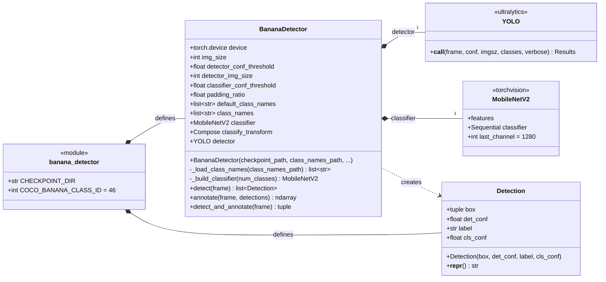
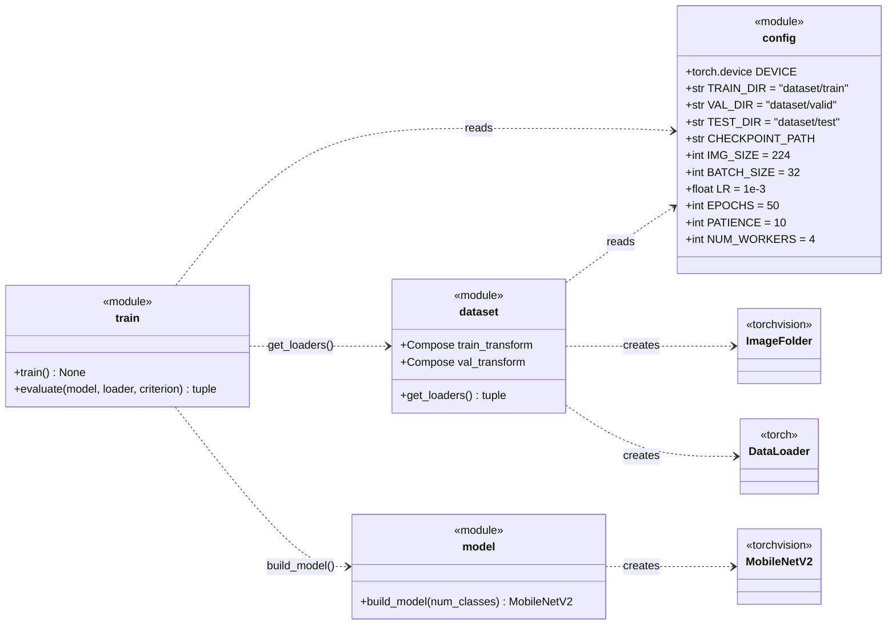
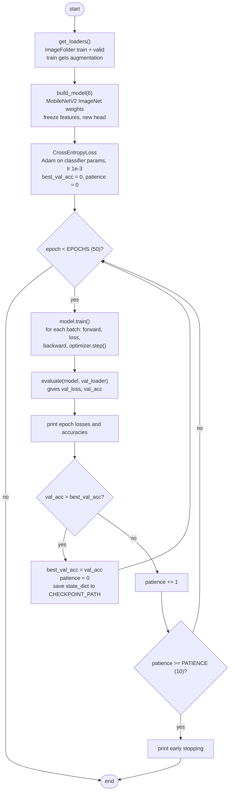

# BananaModel UML Diagrams

UML diagrams for the `BananaModel/` folder. See [README.md](README.md)
for what the model does and how well it performs.

The folder has two separate parts:

- **Training** (`config.py`, `dataset.py`, `model.py`, `train.py`): run
  offline to produce `checkpoints/best_banana_model.pth`.
- **Inference** (`banana_detector.py`): loads that checkpoint and is
  imported by the rest of the project. It does **not** import any of the
  training modules. It builds its own copy of the MobileNetV2 head and
  its own resize/normalise transform.

## 1. Class diagram

Python modules that only contain functions and constants are shown as
`<<module>>` classes.

`get_loaders()` returns `(train_loader, val_loader, class_names)`, and
`evaluate()` returns `(loss, accuracy)`.

## 2. Activity diagram: training (`python train.py`)

