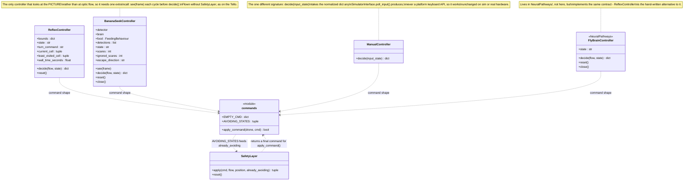
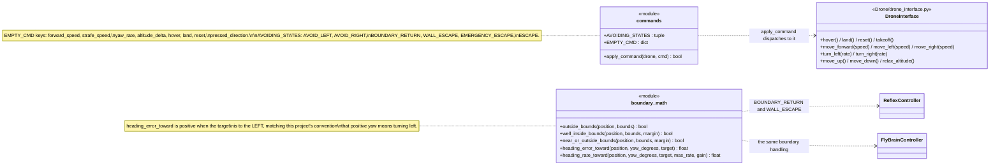
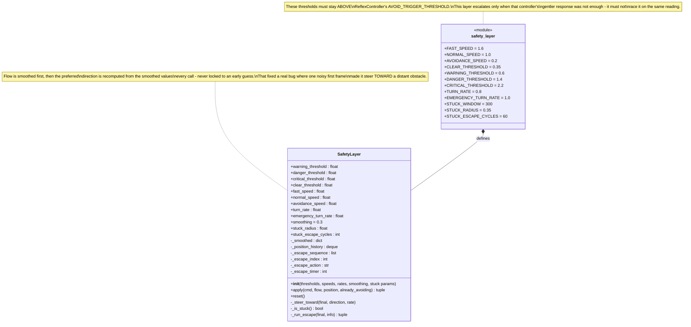
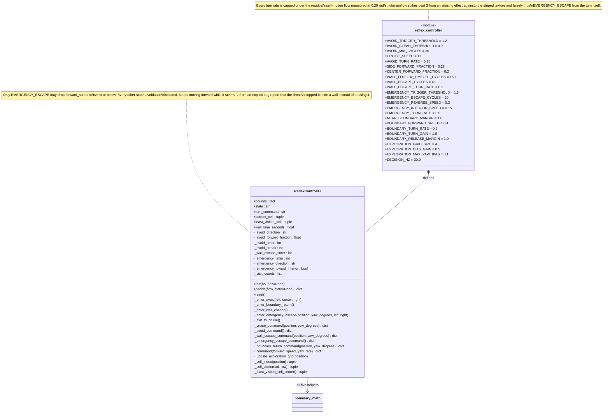
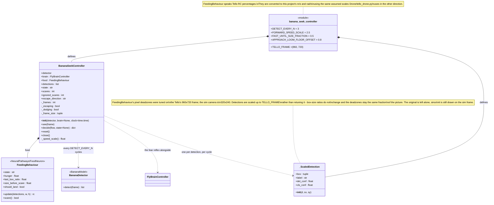
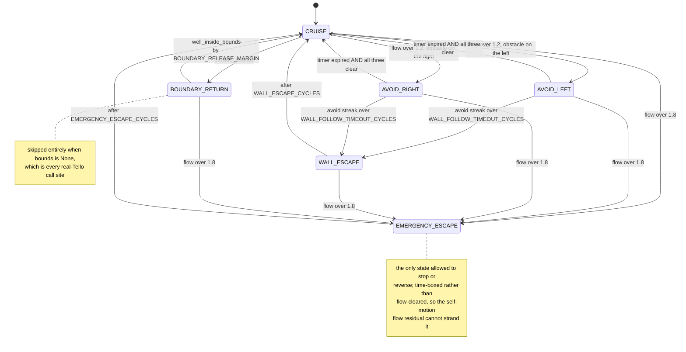
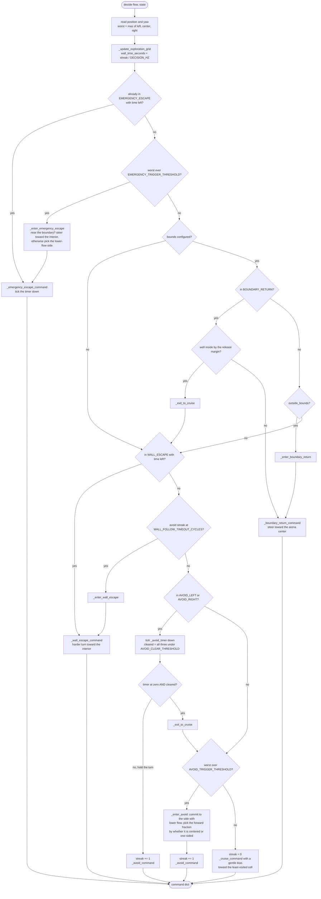
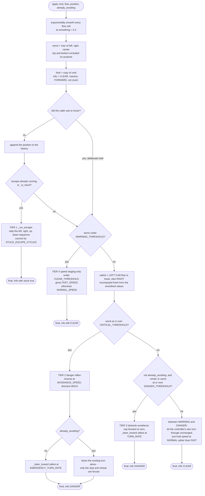
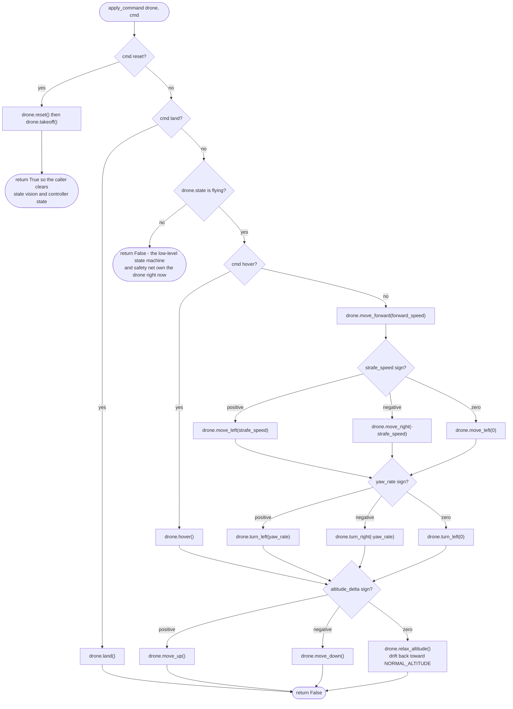
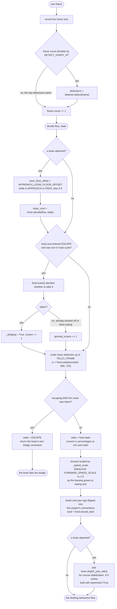

# Controllers — UML

Class, state and activity diagrams for the decision layer. See [README.md](README.md) for what each file is and when each controller is used.

## Architecture (UML)

Five structural views: the shared `decide()` contract and the controllers that implement it, the two stateless modules, `SafetyLayer`, `ReflexController`, and `BananaSeekController`. The activity diagrams below cover the control flow inside them. `-` marks the `_private` helpers (their real names keep the leading underscore).

The whole directory is one pipeline, and the order is the point:

```
    ManualController      \
    ReflexController       >--  SafetyLayer.apply()  -->  apply_command()  -->  DroneInterface
    FlyBrainController    /          (the veto)            (the dispatch)
    BananaSeekController /
```

A controller's output is only ever a *request*. `SafetyLayer` has the final say, which is what makes "hold forward into a wall" impossible. `BananaSeekController` is the exception: `main.py` flies it without a `SafetyLayer`, exactly as the Tello does.

### 1. The `decide()` contract and the controllers

There is no abstract base class here — the contract is duck-typed: a `decide()` method returning a command dict with `EMPTY_CMD`'s keys, plus `.state` and `.reset()`. That is all `main.py` needs, so any of these is a drop-in swap for the others.



`main.py` picks between them with `USE_FLYBRAIN` and `USE_BANANA`. `ReflexController` is also what `Simulator/Evaluation/run_trials.py` uses exclusively; no real-Tello script imports it.

### 2. `commands.py` and `boundary_math.py`

Both are deliberately dependency-free. `commands.py` has no pybullet or cv2 imports, so the real-Tello scripts can use it from an environment that only has djitellopy, opencv and numpy. `boundary_math.py` is pure geometry with no state at all.



`boundary_math`'s helpers only really run against the simulator's bounded course: every real-Tello call site constructs `FlyBrainController(bounds=None, ...)`, and all boundary handling is gated behind a `bounds is not None` check.

### 3. `SafetyLayer` — the override

Sits between whatever produced a command and the motors. It uses the optic-flow 3x3 grid, deliberately *not* the physics-distance net in `Simulator/pybullet_drone.py` — those are two independent backstops, one vision and one ground truth, and either can catch what the other misses.



`STUCK_WINDOW` is 300 cycles (~10 s), up from an earlier 90 (~3 s). The shorter window fired mid-turn, overrode the turn with an unrelated escape, and the two fought: the turn never completed because the detector kept interrupting it.

### 4. `ReflexController` — the hand-written state machine

The non-neural alternative to `FlyBrainController`. This is deliberately where "which side is safer" gets **decided and committed to** — re-picking fresh every frame, which an earlier version did, flip-flops on noisy readings.



`bounds=None` disables boundary containment **and** exploration, since both need a finite area to work within. `AVOID_CLEAR_THRESHOLD` (0.9) deliberately sits above the ~0.6 residual flow a turn generates on its own — otherwise the AVOID state could never see "clear" and would never exit, because its own turning would permanently look like an obstacle to itself.

### 5. `BananaSeekController` — the Tello's banana flight, in the sim

Three pieces wired as on the drone: `BananaModel`'s detector finds the banana, `FeedingBehaviour` decides what to do about it, and the fly brain runs alongside as a background fear reflex.



Two things differ from the Tello **on purpose**. First, the dodge: on the Tello the brain only decides *when* to be scared and `FeedingBehaviour`'s slow back-off is the whole reaction, but the sim's click-to-spawn obstacle closes at 1.5 m/s and that back-off alone gets hit, so in the sim the brain's own tuned dodge flies the drone. Second, the frame scaling above. `APPROACH_LOOM_FLOOR_OFFSET` is added to the loom floor while approaching and eating, because the card growing in view and the pitch as the drone brakes read up to ~1.0 over the floor and fired the Giant Fiber on most arrivals; the thrown test box goes 2–19 over, so it still gets through.

## Activity diagrams

### 6. `ReflexController`'s state machine

Six states, checked in strict priority order every cycle. The `AVOID_LEFT`/`AVOID_RIGHT` names describe **which side the obstacle is on**, not which way the drone turns — an obstacle on the left means turning right, and that is `AVOID_LEFT`.



Exit from `AVOID_*` needs the minimum commitment time elapsed **and** the path actually clear — not either one. With only the timer, a lingering elevated reading right as it expired would still cut the turn short before it got around the obstacle.

### 7. `ReflexController.decide()` — the priority ladder



The exploration bias is only ever layered on top of `CRUISE`, capped at `EXPLORATION_MAX_YAW_BIAS` (0.1 rad/s) — deliberately below `AVOID_TURN_RATE`, so exploration alone cannot generate enough residual self-motion flow to look like an obstacle and falsely trigger avoidance.

### 8. `SafetyLayer.apply()` — the four tiers

Each tier can override everything below it. Note that `worst` is `max(left, right, center)` — **top and bottom deliberately do not contribute** to the trigger decision, only to picking an escape direction once something else triggered.



`already_avoiding` exists because two independent turn-deciders reacting to the same flow reading disagreed often enough in testing to fight each other and spin — an observed bug where oscillating yaw inflated the flow, which fed back into more oscillation. When it is set, this layer still caps speed and still escalates to CRITICAL, but does not layer its own direction choice on top.

`UP` and `DOWN` are excluded from the direction pick for a measured reason: climbing generates genuine optical flow with no de-rotation equivalent for vertical translation, and open sky reads ~0 flow, so `UP` almost always looked safest the instant any tier fired. That created a runaway — climb, the climb generates flow, CRITICAL fires again, climb more — which pinned the drone at the altitude ceiling. They survive only inside the time-boxed stuck-escape sequence.

### 9. `apply_command()` — one command dict to `DroneInterface` calls

The single place a command becomes motion. Called with the **final** command, after the safety layer.



Note the ordering: `reset` and `land` are honoured even when the drone is not `flying`, but every movement command is dropped in any other flight state.

### 10. `BananaSeekController.decide()` — the scare hand-off

`see(frame)` runs first each cycle, caching detections between detector runs. Then `decide()` runs the brain, hands any new Giant Fiber firing to `FeedingBehaviour`, and lets the behaviour fly unless the dodge was taken.



The dodge is only flown when `FeedingBehaviour` *takes* the scare. It turns one down while already backed off (`SCARED`/`WAIT`) or done eating (`DONE`/`LAND`), and then the drone does not react at all, as on the Tello. That matters: `DONE`'s slide to the right fired the Giant Fiber 1.5 s in on 4 of 4 runs — sideways motion past the banana card's edge reads as looming, since the loom floor only discounts forward speed — and flying that dodge threw the drone 2 m/s backwards right after it had finished eating.
