# Drone — UML

Class, state and activity diagrams for the real-drone layer. See [README.md](README.md) for what each file is, how to run the flight tests, and the hardware caveats.

## Architecture (UML)

Six structural views: the drone contract and its Tello implementation, the module-level helpers that have no class, the live flight script, the shared flight harness, the `FlightTests/` scripts, and the analysis/smoke-test layer. The activity diagrams below cover the control flow inside them. Methods marked `*` are abstract; `-` marks the `_private` helpers (their real names keep the leading underscore).

### 1. The drone contract and the Tello implementation

`DroneInterface` is the only thing `main.py` and the controllers know about. `TelloDrone` and `Simulator/pybullet_drone.py`'s `PyBulletDrone` are the two implementations — swapping one for the other changes nothing above this layer.

Unlike the sim there is no PID cascade here: the Tello's own onboard flight controller already turns an RC velocity request into motor output, so this class is bookkeeping plus unit conversion.

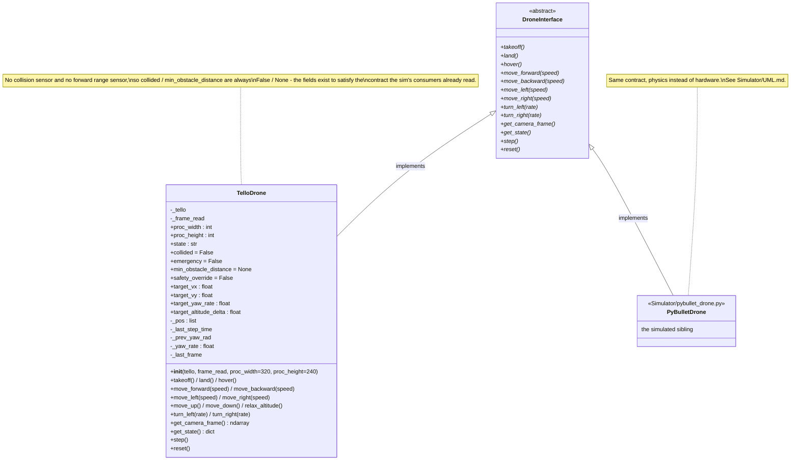

`TelloDrone` has no real position: there is no motion capture or GPS, and the Tello's own `vgx`/`vgy` telemetry is frequently unreliable or zero on non-EDU units. `get_state()["position"]` is dead-reckoned by integrating the last *commanded* body velocity, which is only meant to feed the ESCAPE displacement tracking in `NeuralPathways/flybrain_controller.py` — never absolute navigation. Passing `bounds=None` to the controller skips the boundary logic that would need a real position.

### 2. `tello_drone.py`'s module-level helpers and conventions

The three constants at the top are the whole unit-conversion story, and two of the three are **assumed rather than measured** — see the module docstring.

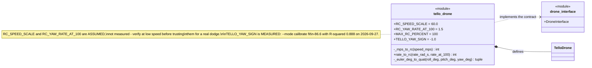

`TELLO_YAW_SIGN` exists because the Tello reports yaw increasing clockwise while this project's convention is counter-clockwise-positive. It is applied once, at the boundary in `get_state()`, so everything downstream is in one convention. It matters because `derotate_flow` subtracts the drone's own rotation and `LoomingDetector` warps frames by orientation — with the sign wrong, both *add* self-motion instead of removing it, so every turn inflates apparent looming.

`tello_neuron_test.py` and `tello_dng02_test.py` read attitude themselves rather than through `get_state()`, so they apply the same constant explicitly through `YawTracker`. Change one and all of them must change.

### 3. `fly_tello.py` and its HUD / log modules

The live "find and eat a banana" script. It is the only thing here that drives the drone through `ScaredEatingBrain` rather than `DroneInterface` — it talks to `djitellopy` directly and sends its own `send_rc_control`.

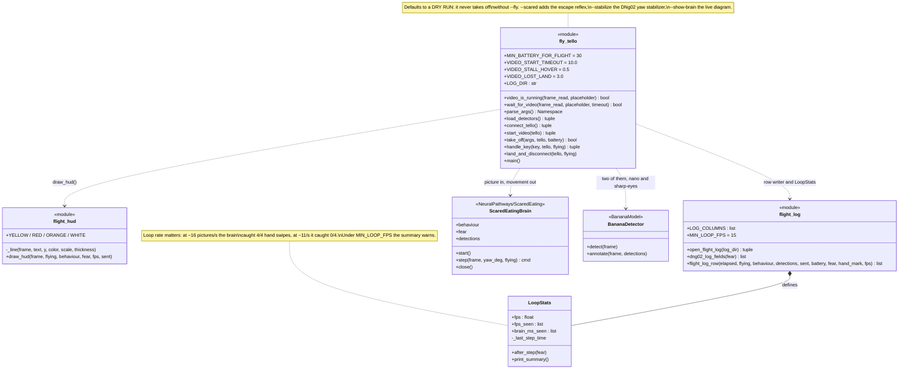

Two detectors are loaded on purpose: a nano model every picture to keep the loop fast enough to catch a hand, and a slower "sharp eyes" YOLOv8s used only while holding still, which found far-away bananas 22/24 against the nano's 7/24.

### 4. `flight_harness.py` — what the `FlightTests/` share

Camera geometry, stream start-up, the plain-text log writer and the attitude readout. Two flavours of the connect/stream helpers live here, as they did in the scripts they came from: the `open_tello`/`open_stream` pair records telemetry availability into a `TelloLogger` for the desk tests, and the `_for_flight` pair takes a print-like callable and warns on low battery for the flight tests. Scripts import whichever pair they need under the names `open_tello`/`open_stream`, which is also what the smoke test patches.

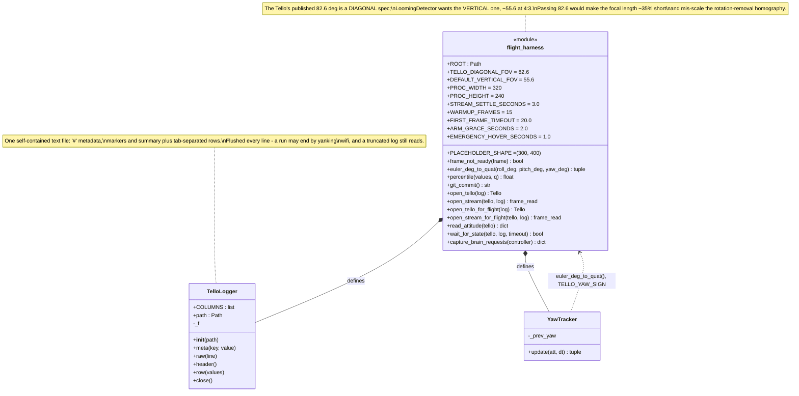

`PLACEHOLDER_SHAPE` is load-bearing. djitellopy 2.5.0's `BackgroundFrameRead` seeds `.frame` with a 400x300 black placeholder and **never** returns `None`, so "no real frame yet" has to be detected by shape and content. Everything here is resized to 320x240 before use, which would hide the shape difference and quietly push black frames through the whole pipeline — zero flow, zero expansion, and a log that looks exactly like "the circuit never fired".

### 5. The `FlightTests/` scripts

Each script is a module with a `main()`; the two logging ones subclass `TelloLogger` with their own `COLUMNS` and keep a `Run` accumulator for the end-of-run summary. The two props-off desk tests never call `takeoff()`, `land()` or `send_rc_control()` at all, so there is nothing to crash.

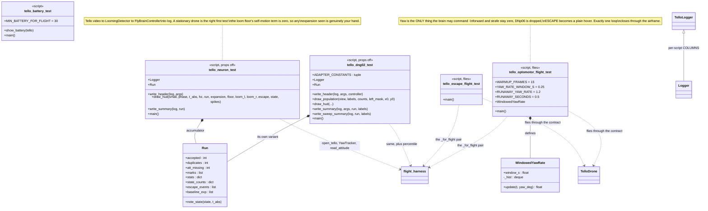

`tello_dng02_test.py` deliberately does not import the network's own constants: `connectome_worker` needs brian2, which this interpreter does not have. They arrive from the subprocess's ready handshake instead, which is strictly better — the log then records what the network was actually built with rather than what this side assumed.

### 6. `dng02_analysis.py` and the smoke test's fakes

`dng02_analysis.py` reads a log back with no drone and no brain, and reports eight PASS/FAIL checks. `test_tello_harness_smoke.py` runs the real `main()` of four scripts against a fake drone, so the per-cycle body and the cv2 HUD are not executing for the first time mid-flight on a live battery.

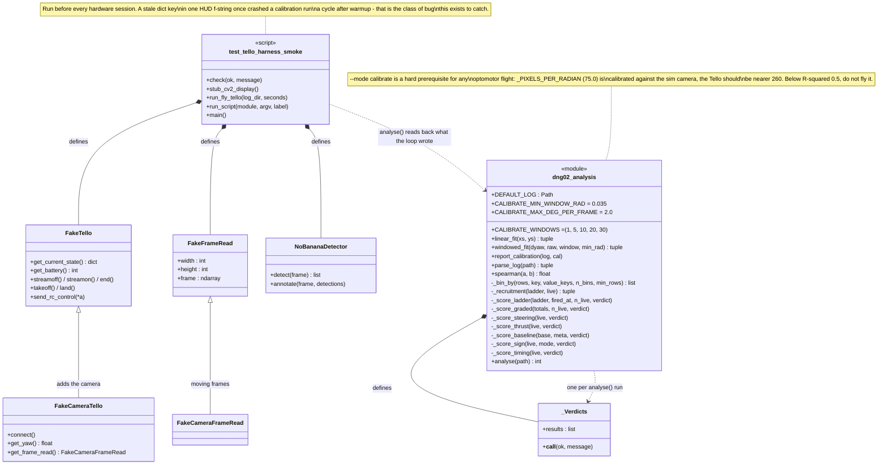

## Activity diagrams

### 7. `TelloDrone` flight state machine

Much simpler than the sim's, because the Tello's SDK calls block: `takeoff()` sets `taking_off`, calls through, and is already `flying` when it returns. There is no `emergency` state — no collision sensor exists to enter it.

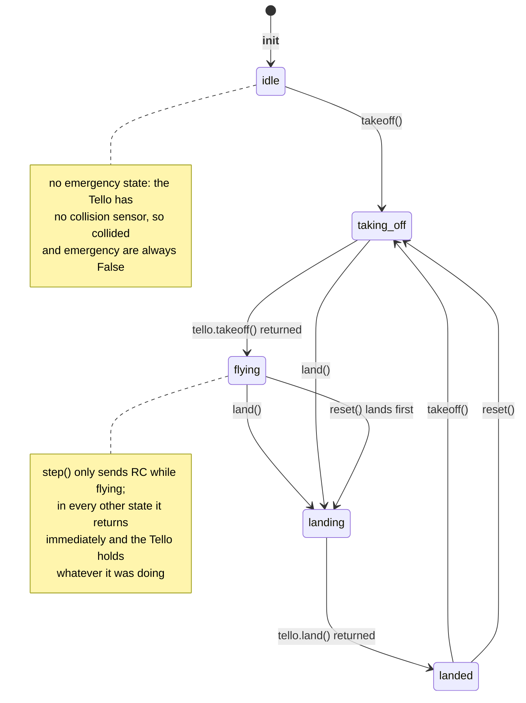

### 8. `TelloDrone.get_state()` and `step()` — one decision cycle

The two halves of a cycle: read the telemetry and dead-reckon a position, then convert the commanded body velocity into an RC packet. Note the two sign flips, which are the easiest thing in this file to get wrong.

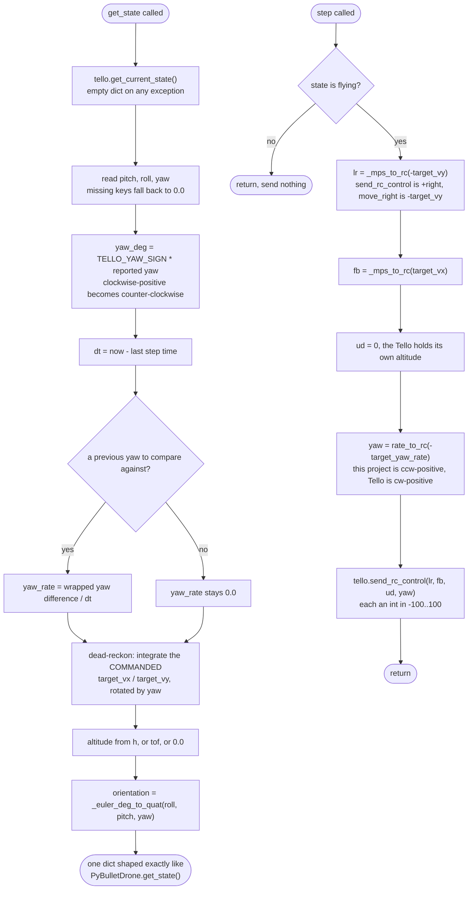

Integrating the command rather than a measured velocity is reasonable here precisely because the Tello's flight controller tracks a commanded RC velocity fairly directly — unlike the sim's mass and PID model, it does not coast much once told to stop. Over a roughly one-second dodge that is good enough for the displacement tracking it feeds.

### 9. `fly_tello.py`'s main loop

The live banana flight. The video-stall ladder is the safety spine: a missing picture first forces a hover, then lands, because the drone is flying blind.

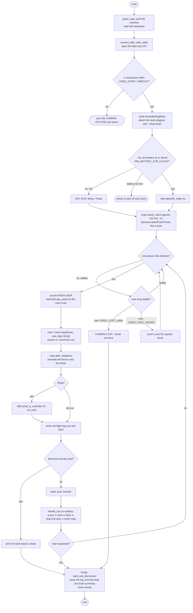

### 10. `tello_neuron_test.py`'s three phases

The props-off desk test, and the one place duplicate-frame rejection is explicit. Processing the same background buffer twice yields zero flow and therefore zero expansion — which looks exactly like "the circuit never fired" while actually being a sampling artifact, so duplicates are skipped and counted separately.

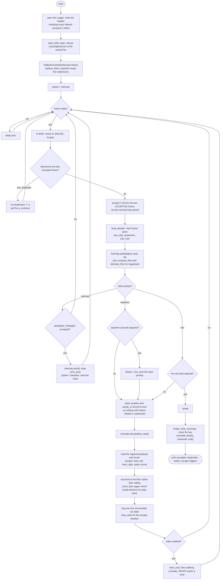

### 11. The two flying tests' abort paths

`tello_escape_flight_test.py` and `tello_optomotor_flight_test.py` share the arming ladder and the two-mode abort. The optomotor test adds a runaway guard, because it is the one test that closes a loop through the airframe and so is the one that can oscillate.

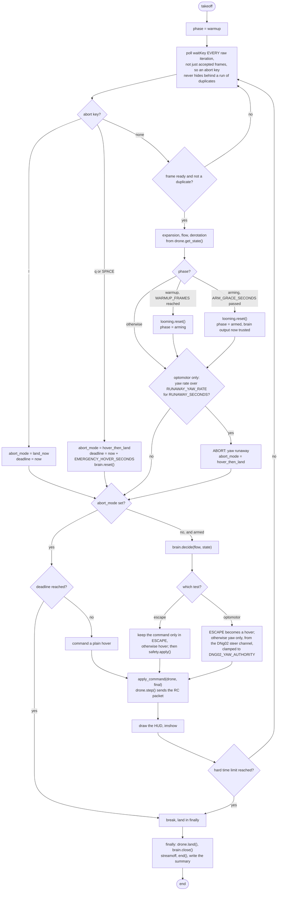

### 12. `dng02_analysis.analyse()` — the eight checks

Run after every `--mode pan` session. A failure here is a measurement, not a crash.

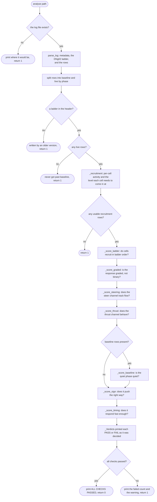

`--mode calibrate` has its own path through `report_calibration()`, which runs `windowed_fit()` at each of `CALIBRATE_WINDOWS` and reports the slope and R-squared per window. That fit is what established `TELLO_YAW_SIGN`: a negative slope means the Tello's yaw sign is opposite to what `derotate_flow` assumes, and with the constant applied a correct value now yields a positive slope.
