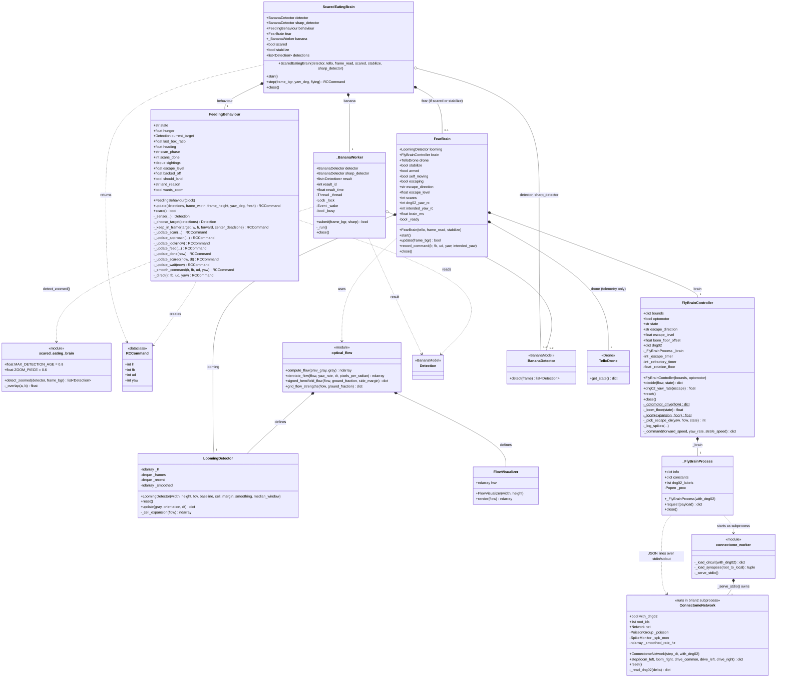
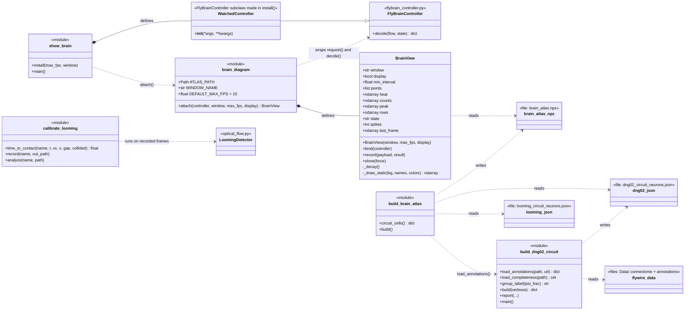
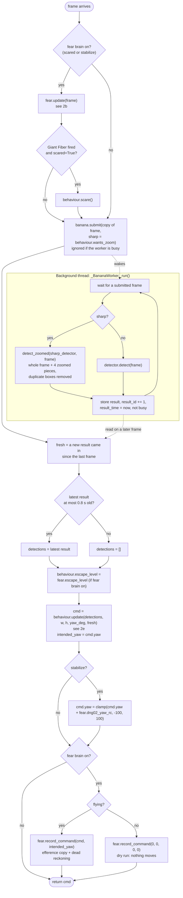
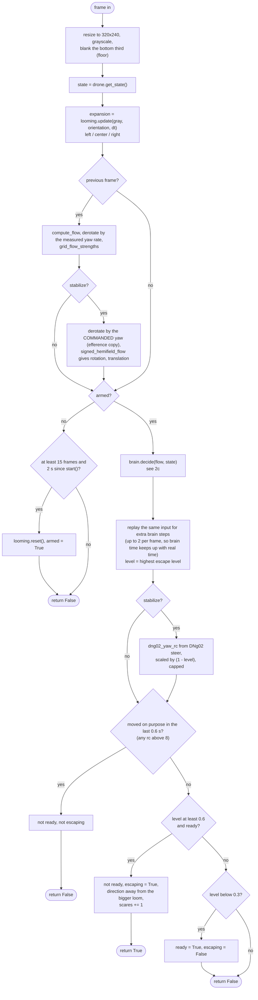
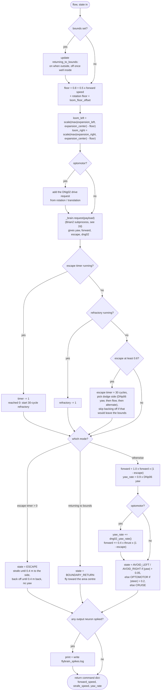
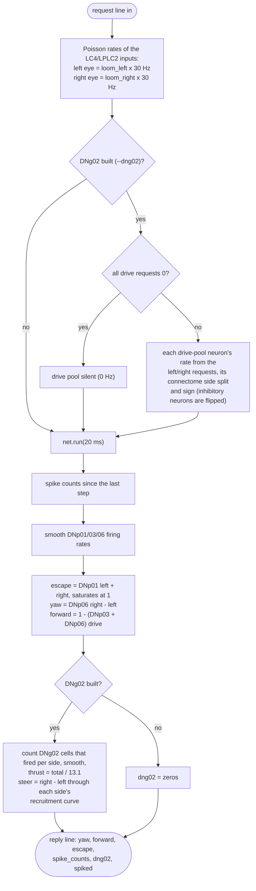
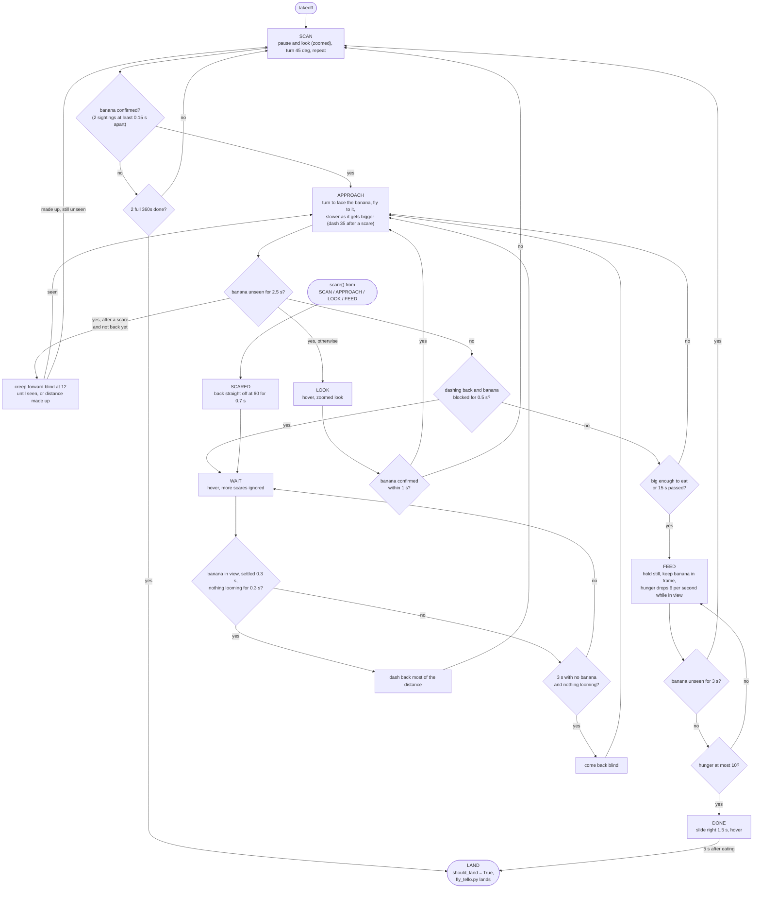

# NeuralPathways UML Diagrams

UML diagrams for the `NeuralPathways/` folder. See [README.md](README.md)
and each subfolder's README for the biology behind the circuits.

The folder has three parts:

- **Runtime brain**: the code that runs once per camera frame on the
  drone or in the simulator. `ScaredEatingBrain` joins the banana-eating
  behaviour (`FoodNeuron/`) to the fear check (`EscapeNeuron/`).
  `FlyBrainController` is the adapter to the real connectome. The
  connectome itself (`connectome_worker.py`) runs in a **separate Python
  process**, because it needs Brian2. The two processes talk by sending
  one JSON object per line over stdin/stdout. Nothing outside that
  process imports `connectome_worker.py`.
- **Offline build scripts**: they create the data files the runtime
  reads (`dng02_circuit_neurons.json`, `brain_atlas.npz`), plus a
  calibration script for the looming detector.
- **BrainView**: an optional live window that shows which neurons are
  spiking. It hooks into an existing `FlyBrainController` without
  changing any flight script.

Test files under the `Tests/` folders are not shown.

## 1. Class diagrams

Python files that only contain functions and constants are shown as
`<<module>>` classes. Classes from outside this folder have a
stereotype naming where they come from.

### 1a. Runtime brain

Most constants are left out. Only the attributes and methods you need to
follow the data flow are shown.

`wants_zoom` is a read-only property.

Who uses these classes from outside the folder:

| Class | Used by |
|---|---|
| `ScaredEatingBrain` | `Drone/fly_tello.py` |
| `FeedingBehaviour` | `ScaredEatingBrain`, `Controllers/banana_seek_controller.py` (simulator) |
| `FlyBrainController` | `FearBrain`, `main.py`, the `Drone/FlightTests/` scripts, the simulator tests |
| `LoomingDetector`, `FlowVisualizer` | `FearBrain`, `main.py`, the flight tests, `EscapeNeuron/Tools/calibrate_looming.py` |

### 1b. BrainView and the offline build scripts

`looming_circuit_neurons.json` was made by hand. No script in this
folder writes it. `connectome_worker.py` reads both neuron JSON files
and the connectivity parquet in `Data/`.

## 2. Activity diagrams

### 2a. One camera frame: `ScaredEatingBrain.step(frame_bgr)`

`Drone/fly_tello.py` calls this once for every picture and sends the
returned command to the Tello. The banana detector runs on its own
thread (right-hand lane), so the frame loop never waits for it.

### 2b. Fear check: `FearBrain.update(frame_bgr)`

Returns `True` only on the frame where a new escape starts.

### 2c. Connectome adapter: `FlyBrainController.decide(flow, state)`

Used by `FearBrain` on the real drone and by `main.py` in the simulator.
`FearBrain` passes `bounds=None`, so the boundary steps never run on the
Tello.

### 2d. One brain step: `ConnectomeNetwork.step(...)` in the Brian2 process

`_serve_stdio()` reads one JSON request per line. A `{"reset": true}`
request calls `reset()` instead. Any other request runs this step and
the result is written back as one JSON line.

### 2e. Banana-eating behaviour: `FeedingBehaviour.update(...)` over a flight

Each call to `update()` runs one step of the current state and may move
to the next one. `scare()` is called from outside by `ScaredEatingBrain`
when the Giant Fiber fires. It only works in `SCAN`, `APPROACH`, `LOOK`
and `FEED`.

