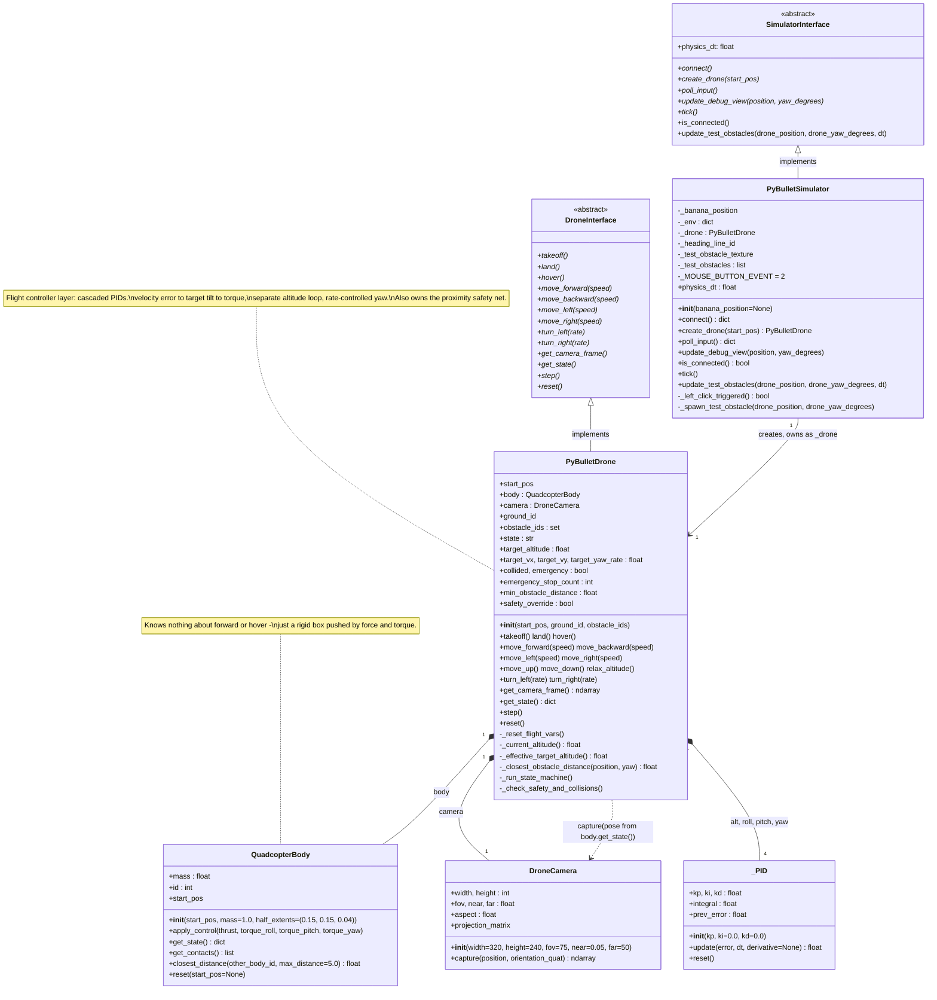
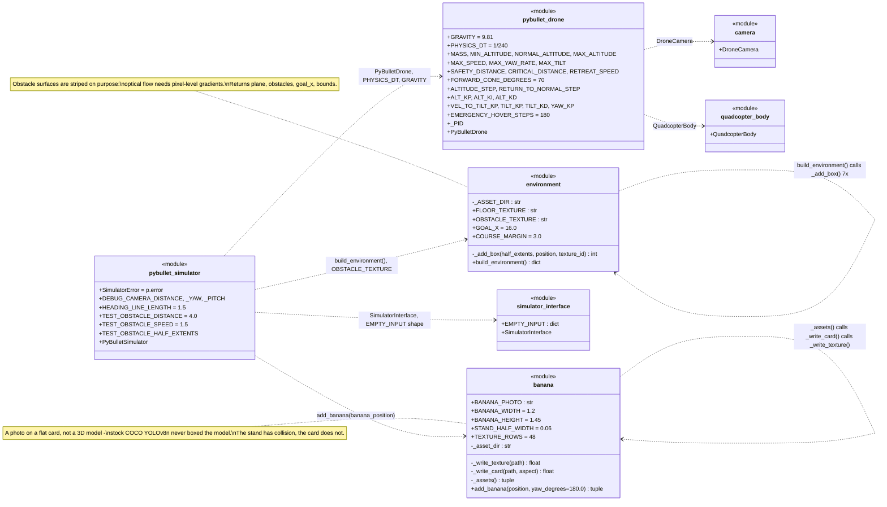
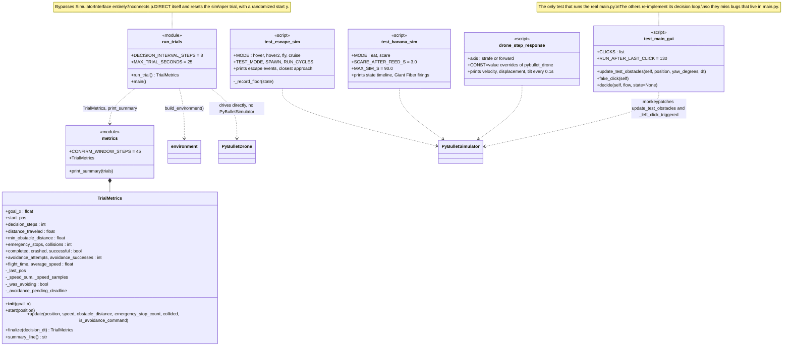
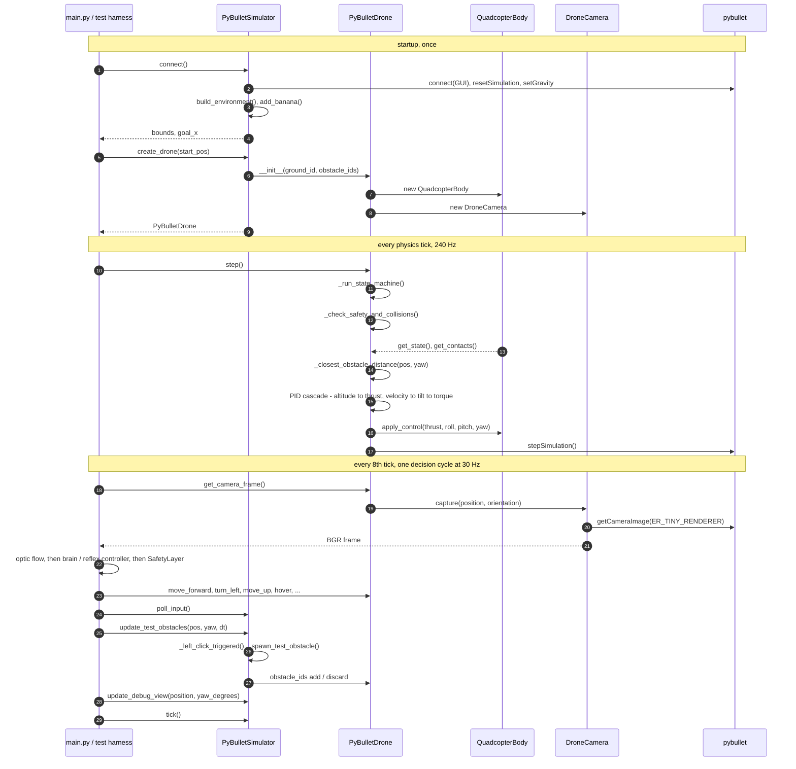
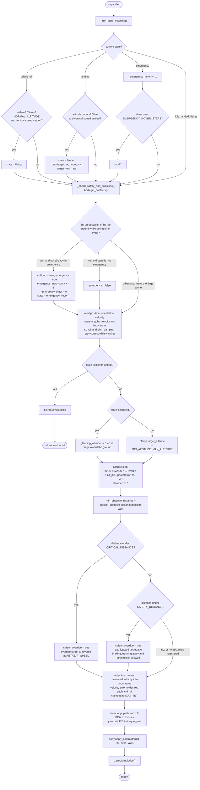
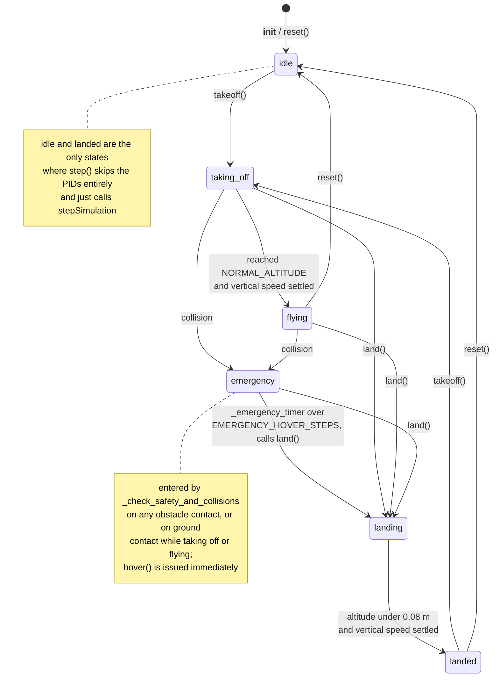
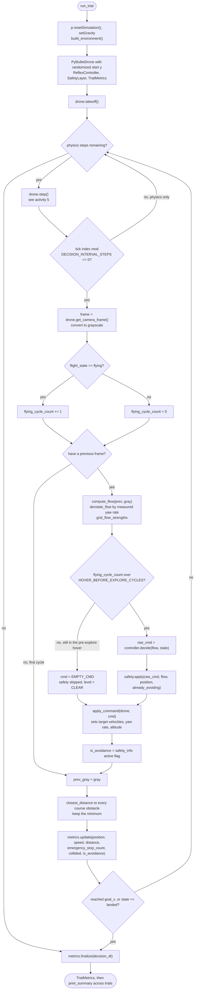
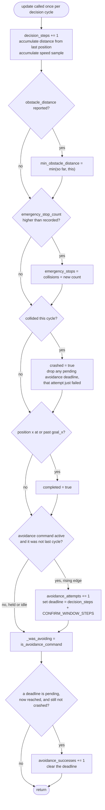
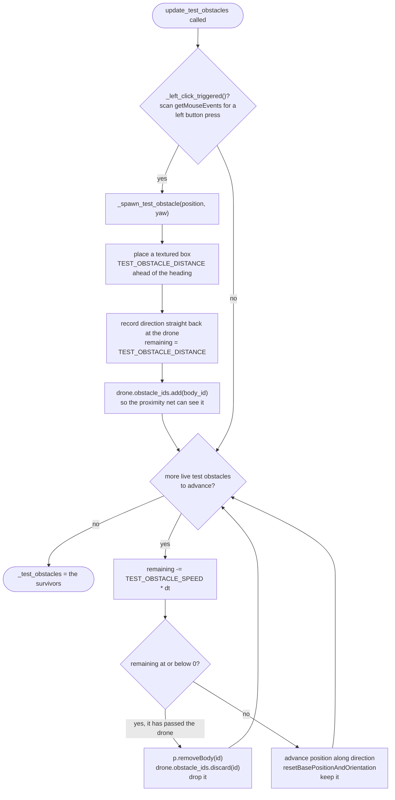

# Simulator

The PyBullet-backed simulator: a virtual drone, camera, and obstacle course, all built behind the same `DroneInterface`/`SimulatorInterface` contracts (`Drone/drone_interface.py`) that the real Tello implements — so `main.py` and everything above this layer stays identical whichever one is plugged in.

## Architecture (UML)

Four structural views of the same code: the runtime classes, the module-level builders that have no class, the evaluation/test layer, and the call sequence that ties them together. The activity diagrams below cover the control flow inside them. Methods marked `*` are abstract; `-` marks the `_private` helpers (their real names keep the leading underscore).

### 1. Runtime classes

The two abstract contracts — `SimulatorInterface` here and `DroneInterface` from `Drone/drone_interface.py` — are the only thing `main.py` knows about. Everything below them is PyBullet-specific and swappable.



### 2. Module-level builders and helpers

`environment.py` and `banana.py` hold no classes at all — only functions plus the tunable constants. `PyBulletSimulator.connect()` is the single caller of both.



### 3. Evaluation, Tests and Tools

`TrialMetrics` is the only class in this layer; everything else is a script that drives the simulator and prints a summary.



### 4. How they talk — one cycle end to end



## Activity diagrams

Where the class diagrams show what exists, these show what *happens* — the branching the code actually takes. Four activities plus the flight state machine they drive.

### 5. `PyBulletDrone.step()` — one physics tick (240 Hz)

The whole control cycle. Note the ordering that matters: the state machine and collision check run *before* the PIDs, and the proximity safety net overwrites `target_vx`/`target_vy` *after* the controller set them but *before* they become a tilt — so it can veto any command, manual or autonomous.



### 6. Flight state machine

`PyBulletDrone.state` — what the decisions in activity 5 are moving between. Only `takeoff()`, `land()` and a collision change it from outside.



### 7. The decision cycle — a full trial

`Evaluation/run_trials.py`'s loop, which is also the shape `main.py` and the three test harnesses use: physics at 240 Hz, decisions every 8th tick at 30 Hz. The pre-exploration hover gate is the subtle part — the safety layer is skipped entirely until the drone has been `flying` long enough, or its stuck-detector primes on the intentional hover.



### 8. `TrialMetrics.update()` — scoring one decision cycle

How an avoidance manoeuvre gets counted. Rising-edge detection means holding a turn for 40 cycles is still one attempt, and an attempt only becomes a success once it has stayed crash-free for `CONFIRM_WINDOW_STEPS` (~1.5 s).



### 9. `update_test_obstacles()` — the on-demand looming stimulus

`PyBulletSimulator`'s debug hook, called once per decision cycle. A left-click conjures a block ahead of the drone's current heading, which then flies straight back at it; the harnesses in `Tests/` call `_spawn_test_obstacle()` directly instead of faking a click.



## Files

| File | What it does |
|---|---|
| `banana.py` | The banana on a stand that `PyBulletSimulator(banana_position=...)` adds: the real photo `Simulator/banana_photo.jpg` on a card, since stock COCO YOLOv8n didn't detect a modelled 3D banana at all in PyBullet's renderer. Detected from ~2.5 m in; nothing at 3 m. |
| `simulator_interface.py` | Abstract `SimulatorInterface` contract between `main.py`/`Controllers/manual_controller.py`'s `ManualController` and whatever hosts the drone — PyBullet today. Mirrors `Drone/drone_interface.py`. |
| `pybullet_simulator.py` | Concrete `SimulatorInterface` backed by PyBullet: owns the GUI window, the test course, keyboard input, and the debug 3D view. Everything here is what would need to change (or disappear) to fly the real drone instead — `main.py` itself stays the same. |
| `pybullet_drone.py` | Concrete `DroneInterface` backed by the PyBullet rigid-body sim — the "flight controller" layer. Turns high-level commands (`move_forward`, `turn_left`, `hover`, ...) into per-step thrust/torque via a cascade of PID loops (outer: velocity → target tilt, inner: tilt → torque, plus a separate altitude loop and rate-controlled yaw), the same shape a real flight controller uses. |
| `quadcopter_body.py` | Raw PyBullet quadcopter body: creation, force/torque application, state readout. Knows nothing about "forward" or "hover" — just a rigid body pushed around by forces. All flight logic lives in `pybullet_drone.py`. |
| `environment.py` | Builds the test course: a textured floor plus a sequence of obstacles (box, narrow passage, pillar) the drone flies through to reach a goal line. Obstacle surfaces use a high-contrast striped texture on purpose — optical flow needs real pixel-level gradients to track. |
| `camera.py` | Forward-facing virtual camera mounted on the drone (`DroneCamera`). Returns plain BGR NumPy frames, same shape as `cv2.VideoCapture` / a real FPV feed. |
| `floor_checker.png`, `obstacle_stripes.png` | The two textures `environment.py` loads. `Website/assets/` keeps its own copies for the site. |
| `banana_photo.jpg` | The banana photo `banana.py` puts on its card. |

## Tests (`Tests/`)

Headless (no GUI window, no keyboard) unless noted otherwise.

### `test_escape_sim.py`: does the drone actually escape?

Replicates `main.py`'s decision loop (camera → optic flow + `LoomingDetector` → `FlyBrainController` → `SafetyLayer` → drone) in a headless PyBullet session. Spawns the same test obstacle a left-click does in the GUI.

| Scenario | What happens | Pass looks like |
|---|---|---|
| `hover` | Hovers unless the brain triggers ESCAPE; obstacle fired straight at the drone | ESCAPE triggers, `collided=False`, closest approach well above 0m |
| `hover2` | Like `hover`, then a second obstacle ~1s after the first dodge ends | Both dodged; still `flying` at ~1.5m; brain state back to `CRUISE` |
| `fly` | Brain flies the drone forward; same obstacle fired head-on | `collided=False` |
| `cruise` | Brain flies the course for 20s, no test obstacle | No escapes unless something is actually close; `collided=False` |

```bash
python Simulator/Tests/test_escape_sim.py hover
python Simulator/Tests/test_escape_sim.py hover2
python Simulator/Tests/test_escape_sim.py fly
python Simulator/Tests/test_escape_sim.py cruise
```

Options: `-v` (every decision cycle), `--gui` (open the PyBullet GUI instead of headless), `--magnitude` (plain optic-flow strength instead of `LoomingDetector`'s expansion, as a baseline), `CONST=value` (override any constant in `NeuralPathways/flybrain_controller.py` for that run). The harness doesn't read the keyboard, so it can't catch bugs in `main.py`'s key handling — still try changes in `python main.py` itself. The brain's inputs are random (Poisson spike trains), so results vary run to run; run each scenario a few times before drawing conclusions.

### `test_main_gui.py`: does the real `main.py` work?

Runs the actual `main.py` (GUI, key handling, `NEURON_TEST_MODE`, the whole loop) and fakes the left-click that spawns a test box at chosen decision cycles. Use it after changing `main.py` — `test_escape_sim.py` re-implements the loop, so it misses bugs that only exist in `main.py` itself.

```bash
python Simulator/Tests/test_main_gui.py                       # boxes at cycles 200, 330, 460
python Simulator/Tests/test_main_gui.py 180,260,400,520,640   # custom click cycles
```

Takeoff plus the pre-explore hover take ~140 decision cycles; a box sent before then is never seen by the brain. Opens the PyBullet and camera windows. A `[sim] transient simulator error` line means PyBullet's GUI dropped one command and `main.py` retried it — expected occasionally.

### `test_banana_sim.py`: does it find the banana, eat it, and come back after a scare?

Replicates `main.py`'s `USE_BANANA` loop headlessly with the real `BananaDetector` (needs torch + ultralytics). The banana sits at `main.BANANA_POSITION`.

| Scenario | What happens | Pass looks like |
|---|---|---|
| `eat` | Nothing thrown at it | SEARCH/APPROACH → FEED → DONE → lands, `collided=False`, no Giant Fiber firing while flying to the banana |
| `scare` | The click-test box is thrown at it 3 s into FEED | Brain fires ESCAPE, box misses, feeding_behaviour goes WAIT → back to FEED, still finishes and lands |

```bash
python Simulator/Tests/test_banana_sim.py eat
python Simulator/Tests/test_banana_sim.py scare
python Simulator/Tests/test_banana_sim.py eat --no-brain       # feeding_behaviour alone, ~45 s wall
```

Options: `-v`, `--gui`, `--no-brain`, `--no-optomotor`. The summary lists every Giant Fiber firing with the food state it came in, including ones feeding_behaviour turned down. Expect some that aren't the box: sideways motion past the banana card's edge reads as looming (the loom floor only discounts forward speed and rotation), so DONE's slide to the right fires it in most runs, and so can a re-approach that has to correct sideways after a dodge. In DONE it's turned down and nothing happens; during a re-approach the drone backs off again and retries, as on the Tello.

## Tools (`Tools/`)

Diagnostics, not pass/fail tests.

### `drone_step_response.py`: how fast can the drone move?

Hovers, commands 2 m/s for 1s then 0 for 1s, printing velocity/displacement/tilt every 0.1s. This is the physical limit on how late an escape can trigger and still get out of the way — with the current gains, ~0.6m sideways takes ~1s.

```bash
python Simulator/Tools/drone_step_response.py strafe
python Simulator/Tools/drone_step_response.py forward
python Simulator/Tools/drone_step_response.py strafe TILT_KP=0.2 TILT_KD=0.04   # try other flight gains
```

`CONST=value` overrides constants in `pybullet_drone.py` for that run only.

## Evaluation (`Evaluation/`)

Not tests in the pass/fail sense — batch benchmarking instead.

| File | What it does |
|---|---|
| `metrics.py` | `TrialMetrics`: per-trial metrics collection plus aggregation/printing across many trials. `update()` is meant to be called once per decision cycle (~20-30 FPS), not once per physics tick. |
| `run_trials.py` | Runs many trials headlessly and prints an aggregate summary. Each trial gets a slightly randomized start position so trials actually differ. |

```bash
python -m Simulator.Evaluation.run_trials --trials 20
```
