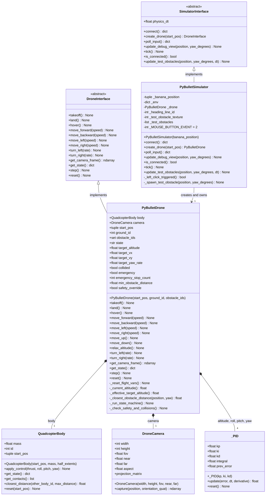
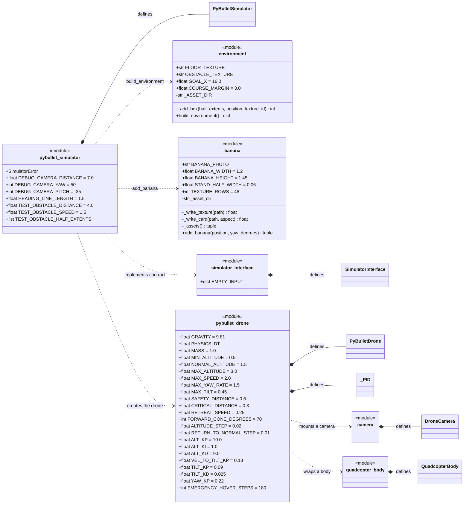
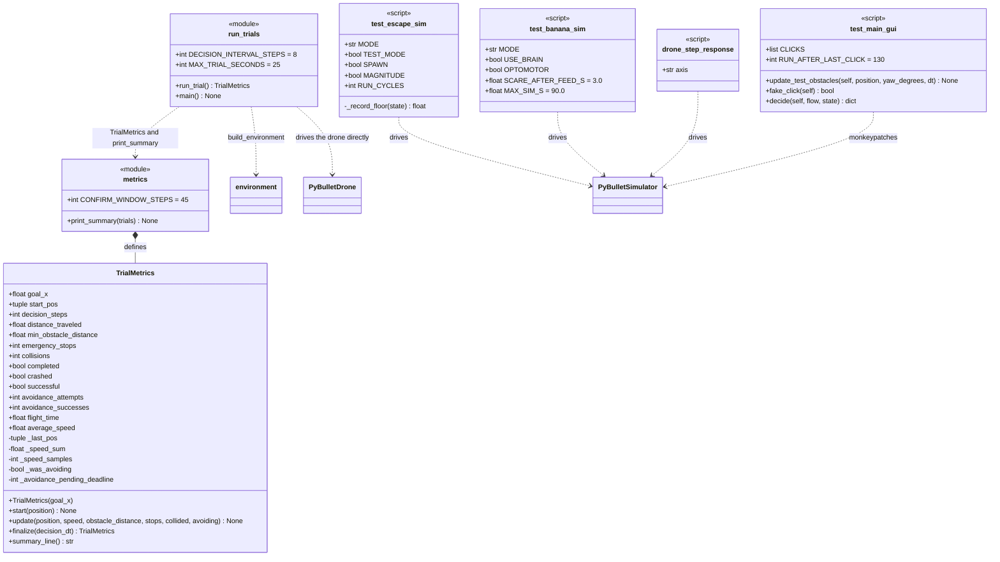
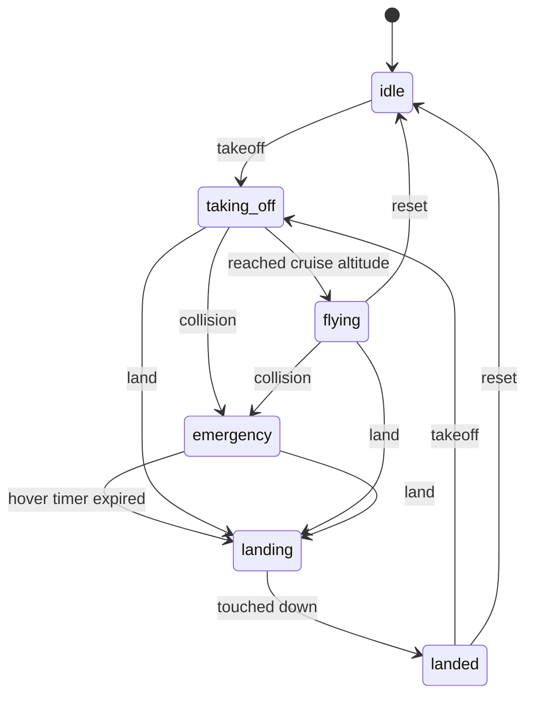
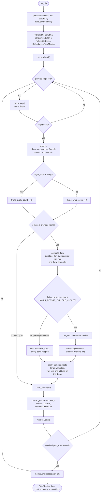

# Simulator UML Diagrams

UML diagrams for the `Simulator/` folder. See [README.md](README.md) for what
each file does and how to run the tests, tools and evaluation.

Python modules that only contain functions and constants are shown as
`<<module>>` classes, following `BananaModel/UML.md`.

The folder has three layers:

- **Contracts** (`simulator_interface.py`, plus `Drone/drone_interface.py`):
  the abstract classes `main.py` talks to. Swapping the sim for the real
  Tello means writing one new implementation of each.
- **PyBullet implementation** (`pybullet_simulator.py`, `pybullet_drone.py`,
  `quadcopter_body.py`, `camera.py`, `environment.py`, `banana.py`): the
  virtual drone, its camera, and the course it flies through.
- **Harnesses** (`Tests/`, `Tools/`, `Evaluation/`): scripts that drive the
  above and print a summary.

## 1. Class diagram: contracts and the flight stack

Every member of `SimulatorInterface` and `DroneInterface` is abstract except
`SimulatorInterface.is_connected()` and
`SimulatorInterface.update_test_obstacles()`, which have working defaults so
real hardware does not have to implement them.



`PyBulletDrone` is the flight-controller layer: cascaded PID loops turn a
desired velocity into a target tilt, that tilt into a torque, and a separate
loop turns a target altitude into thrust, with yaw rate-controlled directly.
It also owns the proximity safety net. `QuadcopterBody` knows nothing about
"forward" or "hover" — it is one rigid box pushed around by force and torque.
`DroneCamera` is handed the pose that `PyBulletDrone` read from
`QuadcopterBody.get_state()`; it never queries the body itself.

`QuadcopterBody` defaults to `mass=1.0` and `half_extents` of 0.15 by 0.15 by
0.04 m; `DroneCamera` defaults to 320 by 240 at a 75 degree field of view.

## 2. Class diagram: modules, builders and constants

`environment.py` and `banana.py` hold no classes at all — only functions plus
the tunable constants. `PyBulletSimulator.connect()` is the single caller of
both.



`PHYSICS_DT` is 1/240 s, so one `step()` is one 240 Hz tick.
`build_environment()` calls `_add_box()` seven times — two perimeter walls, a
box to dodge, two walls forming a narrow passage, and a pillar — then adds a
collision-free goal marker and returns `plane`, `obstacles`, `goal_x` and
`bounds`. Obstacle surfaces are striped on purpose: optical flow needs real
pixel-level gradients to track.

In `banana.py` the call chain is `_assets()` to `_write_card()` to
`_write_texture()`. The banana is a real photo on a flat card rather than a 3D
model, because stock COCO YOLOv8n never boxed the model in PyBullet's
renderer. The stand has collision so the proximity net sees it; the card does
not, since it only needs to be seen.

## 3. Class diagram: harnesses

`TrialMetrics` is the only class in this layer; everything else is a module or
a script.



Two structural details the table in the README does not show.
`run_trials.py` bypasses `SimulatorInterface` entirely: it connects
`p.DIRECT` itself and resets the simulation once per trial, with a randomized
start `y`. `test_main_gui.py` is the only harness that runs the real
`main.py`; it replaces `PyBulletSimulator.update_test_obstacles` and
`_left_click_triggered` on the class, and `FlyBrainController.decide`, to fake
clicks and record escapes. The others re-implement `main.py`'s decision loop,
so they miss bugs that live in `main.py` itself.

`drone_step_response.py` and `test_escape_sim.py` both accept `CONST=value`
arguments that override module constants for that run, in `pybullet_drone.py`
and `flybrain_controller.py` respectively.

## 4. Activity diagram: `PyBulletDrone.step()`, one physics tick

The whole control cycle, run once per 240 Hz tick. The ordering matters: the
state machine and the collision check run before the PIDs, and the proximity
safety net overwrites `target_vx` and `target_vy` after the controller set
them but before they become a tilt — so it can veto any command, manual or
autonomous.

```mermaid
flowchart TD
    start([step called]) --> sm["_run_state_machine()<br/>read altitude and vertical speed"]
    sm --> which{"current state?"}

    which -- taking_off --> arrived{"within 0.05 m of NORMAL_ALTITUDE<br/>and vertical speed settled?"}
    arrived -- yes --> fly["state = flying"] --> coll
    arrived -- no --> coll

    which -- landing --> down{"altitude under 0.08 m<br/>and vertical speed settled?"}
    down -- yes --> grounded["state = landed<br/>zero all three velocity targets"] --> coll
    down -- no --> coll

    which -- emergency --> timer["_emergency_timer += 1"]
    timer --> expired{"timer past EMERGENCY_HOVER_STEPS?"}
    expired -- yes --> autoland["land()"] --> coll
    expired -- no --> coll

    which -- other --> coll

    coll["_check_safety_and_collisions()<br/>body.get_contacts()"] --> hit{"hit an obstacle, or hit the ground<br/>while taking off or flying?"}
    hit -- "yes, and not already in emergency" --> panic["collided = true, emergency = true<br/>emergency_stop_count += 1<br/>_emergency_timer = 0<br/>state = emergency, hover()"] --> read
    hit -- "no, and state is not emergency" --> clear["emergency = false"] --> read
    hit -- otherwise --> read

    read["read position, orientation, velocity<br/>rotate angular velocity into body frame<br/>so tilt damping survives a yaw"] --> motors{"state is idle or landed?"}
    motors -- yes --> idlestep["p.stepSimulation()"] --> off([return, motors off])

    motors -- no --> isLanding{"state is landing?"}
    isLanding -- yes --> ramp["_landing_altitude drifts down<br/>at 0.4 m per second"] --> thrust
    isLanding -- no --> clamp["clamp target_altitude between<br/>MIN_ALTITUDE and MAX_ALTITUDE"] --> thrust

    thrust["altitude loop<br/>thrust = weight plus alt PID output<br/>clamped at zero"] --> near["min_obstacle_distance =<br/>_closest_obstacle_distance<br/>nearest point inside the forward cone"]

    near --> critical{"closer than CRITICAL_DISTANCE?"}
    critical -- yes --> retreat["safety_override = true<br/>override target to reverse<br/>at RETREAT_SPEED"] --> tilt
    critical -- no --> warn{"closer than SAFETY_DISTANCE?"}
    warn -- yes --> cap["safety_override = true<br/>cap forward target at zero<br/>braking and strafing still allowed"] --> tilt
    warn -- "no, or no obstacles" --> tilt

    tilt["outer loop<br/>rotate measured velocity into body frame<br/>velocity error becomes desired pitch and roll<br/>clamped to MAX_TILT"] --> torque["inner loop<br/>pitch and roll PIDs give torques<br/>yaw rate PID gives torque_yaw"]
    torque --> apply["body.apply_control"]
    apply --> sim["p.stepSimulation()"]
    sim --> done([return])
```



Only obstacles roughly ahead count for the safety net —
`_closest_obstacle_distance()` keeps a point only if it lies within
`FORWARD_CONE_DEGREES` of the heading. Without that cone, a wall merely
alongside the drone, being correctly steered around, zeroed forward speed
anyway.

## 5. State diagram: the flight state machine

`PyBulletDrone.state`, which is what the decisions in activity 4 move
between. Only `takeoff()`, `land()`, `reset()` and a collision change it.



`idle` and `landed` are the only states where `step()` skips the PIDs
entirely and just advances the simulation, so the drone sits still with its
motors off. `emergency` is entered by `_check_safety_and_collisions()` on any
obstacle contact, or on ground contact while taking off or flying; `hover()`
is issued immediately, and after `EMERGENCY_HOVER_STEPS` ticks the drone
lands itself.

## 6. Activity diagram: the decision cycle, one trial

`Evaluation/run_trials.py`'s loop, which is the shape `main.py` and the three
test harnesses all use: physics at 240 Hz, a decision every eighth tick at
30 Hz.



The pre-exploration hover gate is the subtle part: until the drone has been
`flying` for `HOVER_BEFORE_EXPLORE_CYCLES`, the controller and the safety
layer are skipped entirely and an empty command is sent, because the safety
layer's stuck-detector would otherwise prime on the intentional hover.

## 7. Activity diagram: `TrialMetrics.update()`

How one decision cycle is scored, and in particular how an avoidance
manoeuvre gets counted.

```mermaid
flowchart TD
    start([update, once per decision cycle]) --> acc["decision_steps += 1<br/>add distance from the last position<br/>add a speed sample"]
    acc --> hasDist{"an obstacle distance was reported?"}
    hasDist -- yes --> keepMin["min_obstacle_distance keeps the smaller"] --> stops
    hasDist -- no --> stops

    stops{"emergency_stop_count above the record?"}
    stops -- yes --> bump["emergency_stops and collisions<br/>both take the new count"] --> crashed
    stops -- no --> crashed

    crashed{"collided this cycle?"}
    crashed -- yes --> fail["crashed = true<br/>drop any pending avoidance deadline,<br/>that attempt just failed"] --> goal
    crashed -- no --> goal

    goal{"position x at or past goal_x?"}
    goal -- yes --> complete["completed = true"] --> edge
    goal -- no --> edge

    edge{"avoidance command active now<br/>but not last cycle?"}
    edge -- "yes, rising edge" --> attempt["avoidance_attempts += 1<br/>deadline = now plus CONFIRM_WINDOW_STEPS"] --> remember
    edge -- "no, held or idle" --> remember

    remember["_was_avoiding = the current flag"] --> due{"a deadline is pending, now reached,<br/>and still not crashed?"}
    due -- yes --> win["avoidance_successes += 1<br/>clear the deadline"] --> out
    due -- no --> out
    out([return])
```



Rising-edge detection means holding a turn for forty cycles is still one
attempt, and an attempt only becomes a success once it has stayed crash-free
for `CONFIRM_WINDOW_STEPS`, about 1.5 s at 30 Hz.

## 8. Activity diagram: `update_test_obstacles()`

`PyBulletSimulator`'s debug hook, called once per decision cycle. A left
click conjures a block ahead of the drone's current heading, which then flies
straight back at it — a looming stimulus on demand, instead of waiting to
stumble into a real obstacle.

```mermaid
flowchart TD
    start([update_test_obstacles]) --> click{"_left_click_triggered?<br/>scan getMouseEvents for<br/>a left button press"}
    click -- yes --> spawn["_spawn_test_obstacle"]
    spawn --> place["place a textured box<br/>TEST_OBSTACLE_DISTANCE ahead of the heading"]
    place --> aim["record a direction straight back at the drone<br/>remaining = TEST_OBSTACLE_DISTANCE"]
    aim --> register["drone.obstacle_ids.add<br/>so the proximity net can see it"]
    register --> loop
    click -- no --> loop

    loop{"another live test obstacle?"}
    loop -- no --> out([keep only the survivors])
    loop -- yes --> advance["remaining decreases by<br/>TEST_OBSTACLE_SPEED times dt"]
    advance --> past{"remaining at or below zero?"}
    past -- "yes, it has passed the drone" --> drop["p.removeBody<br/>drone.obstacle_ids.discard<br/>forget it"] --> loop
    past -- no --> move["advance the position<br/>resetBasePositionAndOrientation<br/>keep it"] --> loop
```

The harnesses in `Tests/` call `_spawn_test_obstacle()` directly rather than
faking a click, except `test_main_gui.py`, which replaces
`_left_click_triggered()` so that the real `main.py` loop does the spawning.
